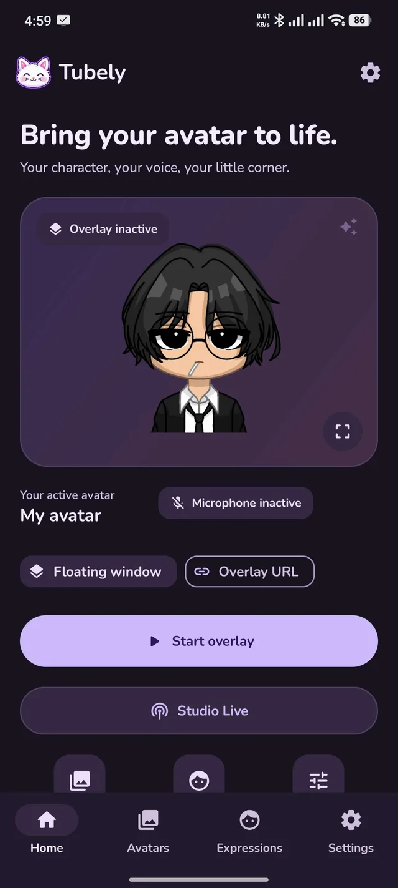
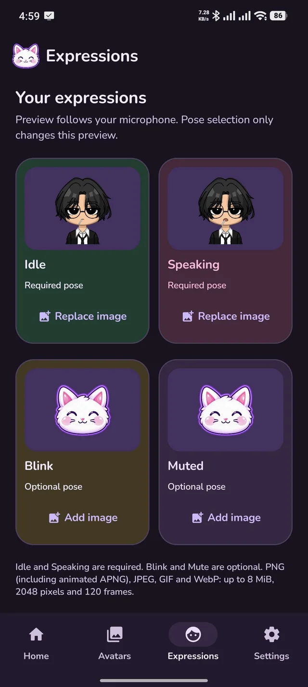
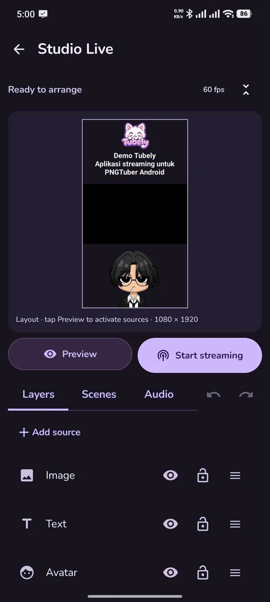
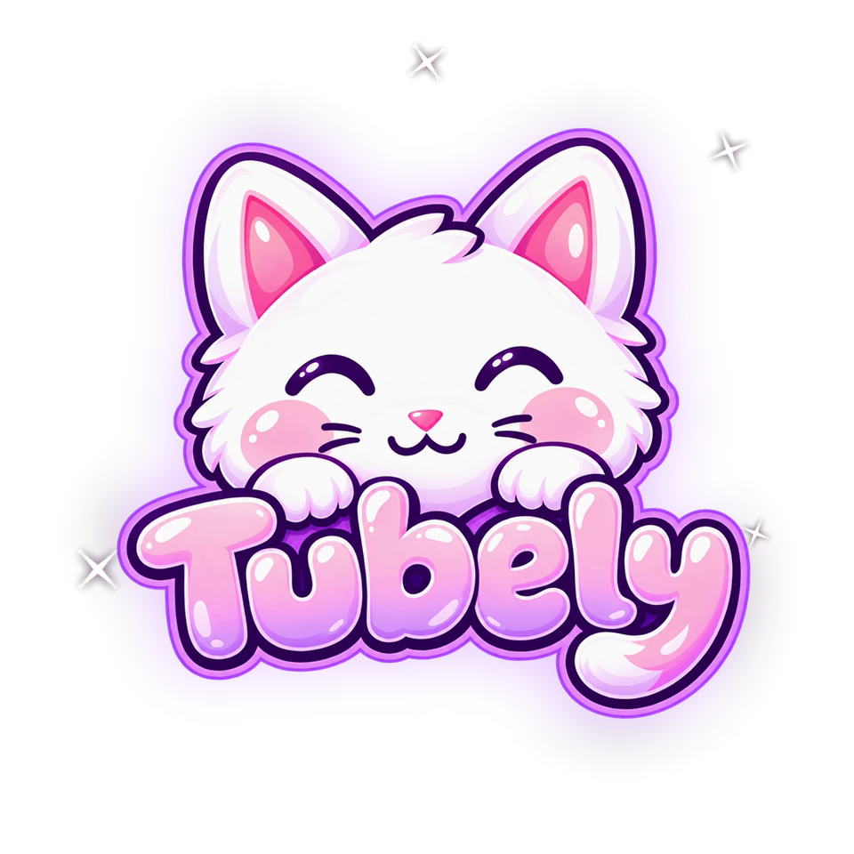

  
  
Your avatar. Your stream. All from Android.

  

    <a href="https://github.com/clynomious/Tubely-builds/releases/tag/v0.1.0-beta.13"><strong>Download Beta 13</strong></a>
    &nbsp; · &nbsp;
    <a href="https://github.com/clynomious/Tubely-builds/releases">All releases</a>
  

  
Android 8.0+ &nbsp; · &nbsp; TikTok &amp; YouTube &nbsp; · &nbsp; English &amp; Bahasa Indonesia

## Make it your stream

Bring your PNG avatar to life with your voice, arrange a scene, and go live from your phone.

  
  &nbsp;
  
  &nbsp;
  

  
   
  <a href="public/media/tubely-overlay.webm">Watch the overlay demo →</a>

| Choose your setup | What you can do |
| :--- | :--- |
| **Studio Live** | Combine screen/game, camera, avatar, image, video, text and browser URL sources. Broadcast with your server URL and stream key. |
| **Floating avatar** | Place your avatar over other apps. Drag, resize, adjust opacity or enable click-through. |
| **Overlay URL** | Add your avatar to a streaming app on the same phone, or OBS and LIVE Studio on your local network. |

- Separate portrait and landscape compositions.
- Edit layer properties beside or below the preview. Drag to reorder layers, adjust transforms, snap, duplicate, and undo or redo edits.
- Local video sources with playback, seeking, looping and audio controls; one video per scene.
- Output options up to 1080p and a selectable target up to 60 fps.
- Floating TikTok chat and live statistics.
- Join notifications, gifts and grouped likes in live chat, with clearer names and messages.
- Microphone noise suppression and separate game audio controls.
- Sign in to Restream, sync your channels and import its streaming server settings.
- Edit supported Restream channel titles, descriptions and active destinations from Tubely.
- Configure Tubely-managed YouTube broadcasts with a separate YouTube sign-in, including categories, privacy and thumbnail uploads.
- Animated avatars and portable `.tbly` profile backups.
- Add multiple browser overlays to a scene.
- Automatic update checks with a short changelog when opening the app, plus in-app downloads and installation. Manual checks, creator links and Trakteer support are available in **About**.

## Get started

1. **Install Tubely.** Open the latest release above and download the `.apk` from **Assets**.
2. **Create your avatar.** Import your images and adjust its voice response.
3. **Choose your setup.** Open Studio Live, Floating avatar or Overlay URL, then connect your streaming destination.

Your streaming account needs live access. Enter a server URL/stream key for direct broadcasting, or sign in to Restream and review your active destinations there before using its server in Tubely. Available capture modes and actual resolution/FPS depend on your device and source. This is a beta; see each release for its changes and known limitations.

**Moving from Beta 11 or earlier:** Beta 12 uses the new Android package `cly.tubely.app` and installs as a separate app. Export your profiles as `.tbly` in the old app, install the new APK manually, then import the backup. Settings, permissions and account sign-ins need to be set up again. The old app's updater cannot install this package as an update.

## Website source

The Next.js landing page lives directly at the repository root. It includes interactive avatar previews, the original app screenshots, and direct APK downloads that follow GitHub releases. See [website development notes](WEBSITE.md).

For local development, run `npm install` and `npm run dev` from this directory.

### Deploy to Vercel

Import this repository, choose **Next.js**, and keep **Root Directory** at **`./`**. Leave the build and output settings at their framework defaults. If the project previously used `website` as its root, change that setting to `./`.

Set `NEXT_PUBLIC_SITE_URL` to your public HTTPS domain for social sharing previews. If omitted, the website uses Vercel's production domain when available. No GitHub token is needed for release downloads.

## Support Tubely

Help Tubely grow and bring new updates sooner.

**[Support Tubely on Trakteer →](https://trakteer.id/clynomious)**

## Meet the creator

Built by **@clynomious**.

  <a href="https://github.com/clynomious"> GitHub</a>
  &nbsp; · &nbsp;
  <a href="https://www.tiktok.com/@clynomious"> TikTok</a>
  &nbsp; · &nbsp;
  <a href="https://www.instagram.com/clynomious/"> Instagram</a>

